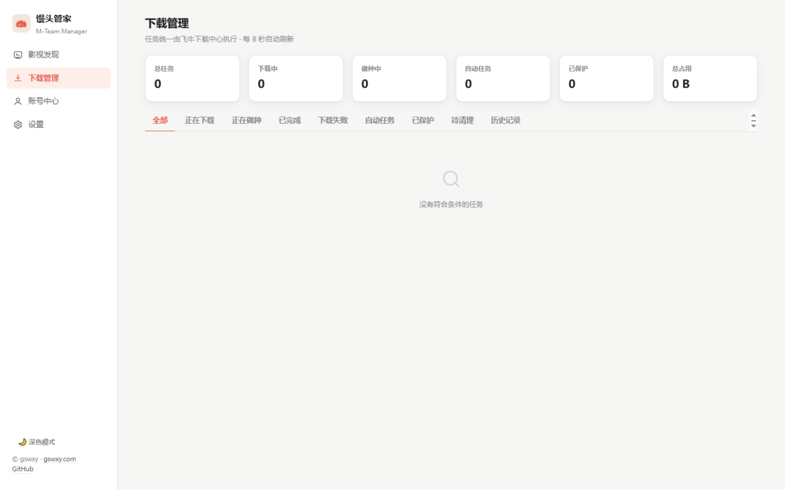
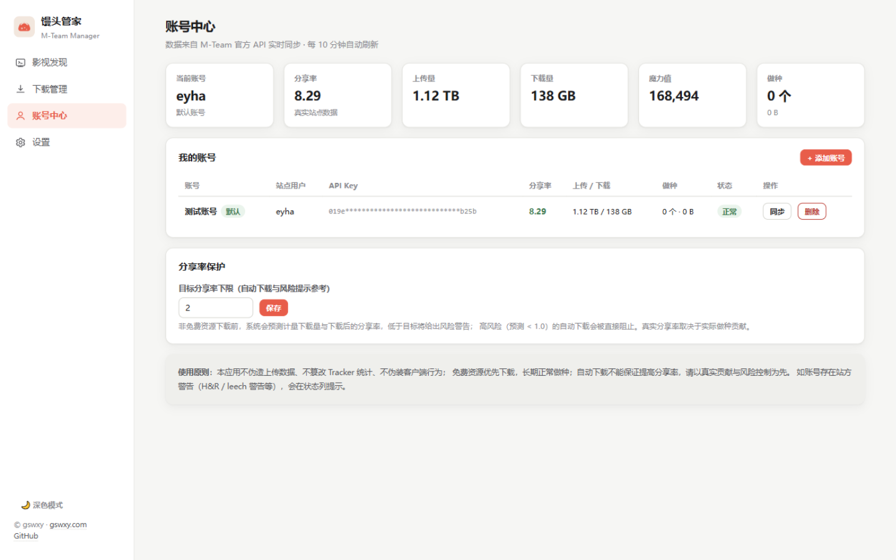
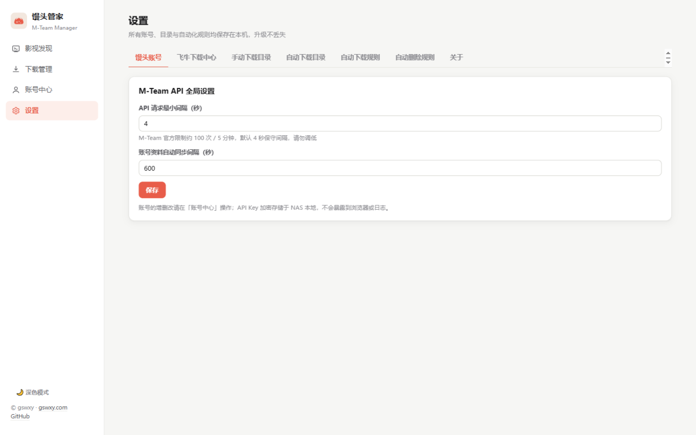

# 馒头管家 M-Team Manager for fnOS

[](https://github.com/gswxy/mteam-manager-fnos/actions/workflows/ci.yml)
[](https://github.com/gswxy/mteam-manager-fnos/releases)
[](LICENSE)

**馒头管家** 是一款飞牛 fnOS 原生应用（`.fpk`），为 [M-Team（馒头 PT 站）](https://wiki.m-team.cc/api)提供影视发现、下载管理、多账号中心与自动化下载/清理能力，**原生对接飞牛下载中心**，不依赖 qBittorrent、Docker 或任何额外下载器。

> 作者：**gswxy** · [gswxy.com](https://gswxy.com) · [GitHub](https://github.com/gswxy)
> 本项目为第三方开源工具，与 M-Team、飞牛 fnOS 官方无隶属或认证关系。

## ✨ 功能

### 影视发现
- 最新发布 / 热门资源 / 豆瓣高分 / 免费资源四种浏览方式，电影、电视剧、动漫、综艺分类
- 关键词搜索、1080p/4K 画质与体积筛选、促销状态（免费 / 2X / 50%）筛选
- 同一作品的不同版本按豆瓣 ID / IMDb ID / 标题智能聚合为一个影视条目
- 详情页展示海报、评分、资源版本、做种人数、促销剩余、简介、MediaInfo 与分享率风险预测
- 榜单基于已抓取种子样本聚合排序，界面明确标注覆盖范围，评分只展示站点返回数据，绝不伪造

### 下载管理
- 正在下载 / 做种中 / 已完成 / 失败 / 自动任务 / 已保护 / 待清理 / 历史记录八种视图
- 实时速度、进度、上传量、分享率；暂停 / 恢复 / 删除 / 永久保留
- 手动与自动任务统一追踪，自动任务显示命中规则与下载原因
- 三重去重：本地任务表 → 站点下载历史（tracker/queryHistory）→ 下载中心在途任务

### 账号中心
- 多个 M-Team 账号（官方 API 存取令牌），连接测试、账号切换、资料自动同步
- 用户等级数据、分享率、上传/下载量、魔力值、做种数量与体积、保种质量指标
- H&R / 站方警告风险提醒；下载前预测计量下载量与分享率风险
- 可配置分享率保护目标，高风险自动下载会被直接阻止

### 自动化（默认全部关闭，配置后自行开启）
- **自动下载规则**：影视偏好 / 免费资源 / 保种三类规则，支持类别、画质、体积区间、促销策略、做种人数、关键词、每日上限、并发上限、空间预算、运行时间段；支持**规则预览**（不实际下载）
- **自动删除规则**：只清理本应用创建的自动任务；永久保护、手动任务、未完成任务绝不清理；保留天数 + 最短做种时长 + 单种分享率 + 上传活跃度多门限；H&R 标记或义务无法确认时**禁止删除**；空间配额与 NAS 最低剩余空间触发；无可安全删除资源时停止新增自动下载并告警；删除通过飞牛下载中心接口执行，保证做种状态一致，并有文件级兜底核对
- 下载前重新校验促销状态、重复任务、空间预算与安全条件

### 安全
- API Key 与 NAS 凭据在服务端加密存储（密钥文件 0600），不回传浏览器、不写入日志
- Web 界面通过 fnOS 统一网关接入，复用飞牛登录态（应用只监听 Unix Socket，不暴露独立端口）
- 下载目录仅允许 `/volN/...` 形式路径，防路径穿越与软链越界；添加与删除幂等，防并发重复
- 遵守 M-Team 官方频率限制（默认 4 秒请求间隔）；账号异常、接口失败、磁盘不足时安全停止自动操作
- 升级不丢配置；卸载默认保留应用数据，**绝不触碰已下载的影视文件与 PT 做种数据**

## 📦 安装

1. 从 [Releases](https://github.com/gswxy/mteam-manager-fnos/releases) 下载最新 `mteam-manager_x.y.z_x86.fpk`（ARM64 设备下载 `_arm` 版本）
2. 飞牛 fnOS → **应用中心 → 手动安装**，选择 `.fpk` 文件
3. 安装向导可顺带填写 fnOS 账号（用于对接下载中心，也可稍后在应用内配置）
4. 桌面出现「馒头管家」图标，点击打开

### 首次配置

1. **设置 → 馒头账号**：添加 M-Team API Key（馒头站 → 控制面板 → 实验室 → 存取令牌），选择对应站点域名
2. **设置 → 飞牛下载中心**：填写 fnOS 用户名密码 →「保存并测试连接」，看到 ✓ 即对接成功
3. **设置 → 手动下载目录 / 自动下载目录**：用文件夹选择器配置保存路径（自动目录与手动目录完全隔离）
4. 到「影视发现」搜索、下载；如需自动化，在「设置 → 自动下载规则 / 自动删除规则」中配置并开启

## 🖼 界面预览

| 影视发现 | 下载管理 |
|---|---|
|  |  |

| 账号中心 | 设置 |
|---|---|
|  |  |

浅色为主、支持深色模式、手机浏览器自适应。

## ⚠️ 风险与合规说明

- 本应用只调用 M-Team 官方 API 与飞牛下载中心接口，**不伪造上传数据、不篡改 Tracker 统计、不伪装客户端行为、不绕过站点考核**
- 自动下载不能保证提高分享率；免费资源优先、长期正常做种、以真实贡献与风险控制为原则
- 自动删除采用保守策略：任何义务无法确认的任务都不会被删除；请自行确认站点当前的 H&R / 保种政策并合理设置保留参数
- PT 站点规则可能变化，请遵守 [M-Team 使用条款](https://m-team.cc)

## 🛠 开发

```bash
# 后端（Python 3.11+）
cd backend && pip install -r requirements.txt
MTM_DEV=1 MTM_DATA_DIR=./data python -m app.main     # 监听 http://127.0.0.1:8686

# 前端（Node 18+）
cd frontend && npm install && npm run dev             # Vite 代理到 8686

# 测试（模拟 M-Team HTTP 服务 + 模拟 fnOS WebSocket 下载中心）
cd backend && python -m pytest

# 构建 FPK（x86 / arm）
scripts/build_fpk.sh x86
```

技术栈：React 18 + TypeScript + Vite ／ FastAPI + SQLite + APScheduler ／ 内嵌 [python-build-standalone](https://github.com/astral-sh/python-build-standalone) 运行时，安装后不依赖系统 Python / Node。

## 📄 许可证

[MIT](LICENSE) © [gswxy](https://gswxy.com)。第三方代码许可与版权声明见 [THIRD_PARTY_NOTICES.md](THIRD_PARTY_NOTICES.md)。

## 🙏 致谢

- [M-Team-Helper](https://github.com/spellyaohui/M-Team-Helper)（spellyaohui，MIT）—— M-Team API 行为参考
- [FNOS-API](https://github.com/heijiangangqin/FNOS-API) —— 飞牛下载中心对接思路参考（本项目为独立实现，未复制其代码）
- [python-build-standalone](https://github.com/astral-sh/python-build-standalone)（astral-sh，MIT）—— 内嵌 Python 运行时
- FastAPI / SQLAlchemy / APScheduler / httpx / websockets / React / Vite 等开源项目
